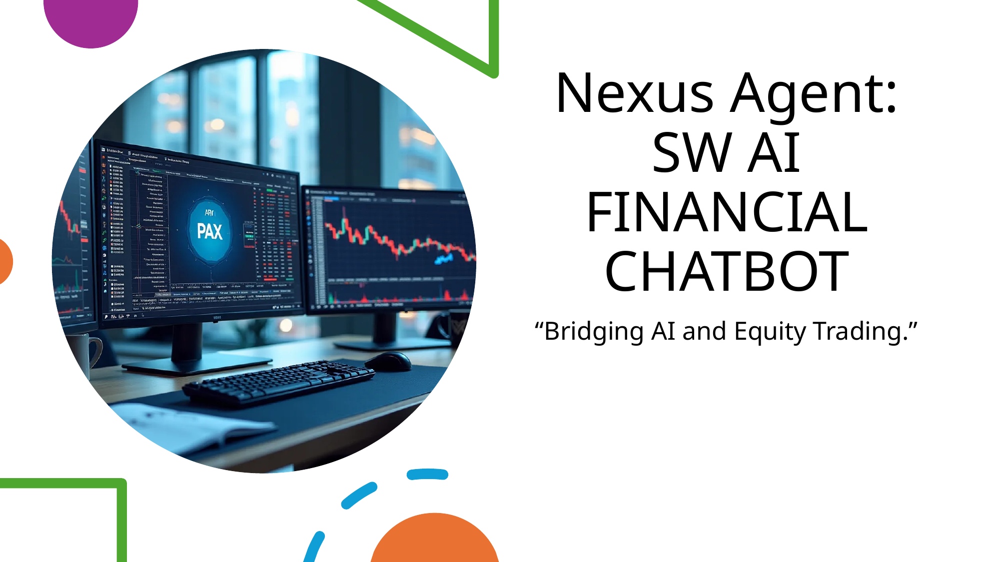
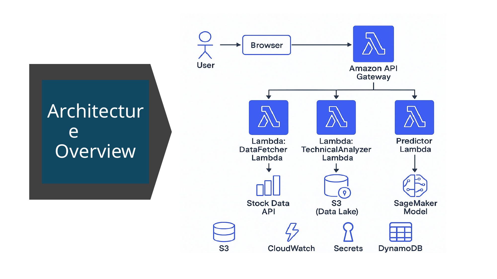
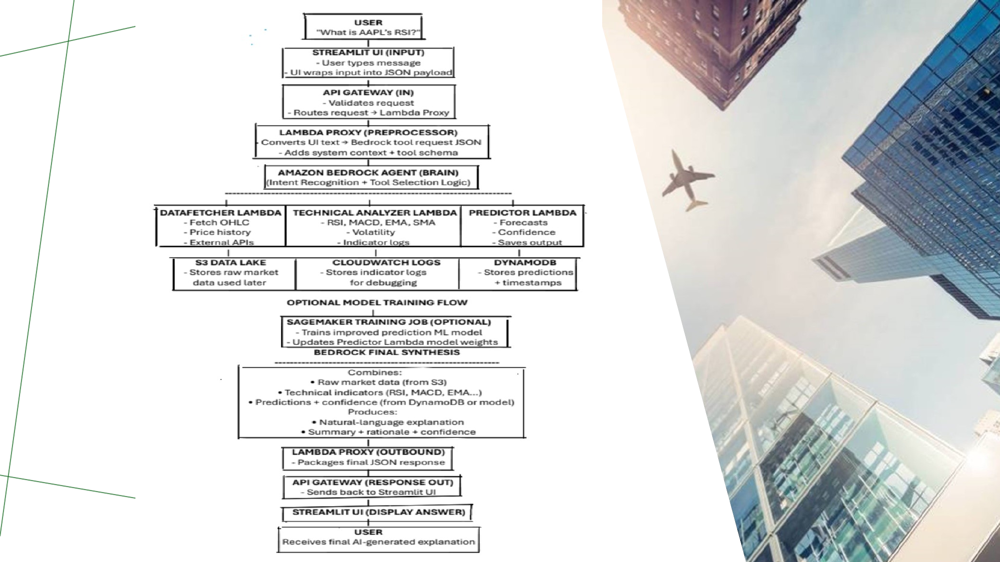
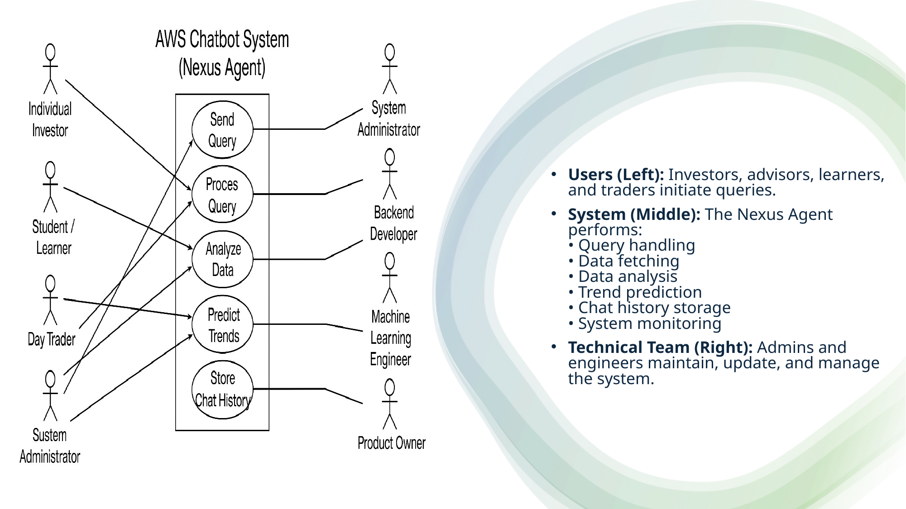
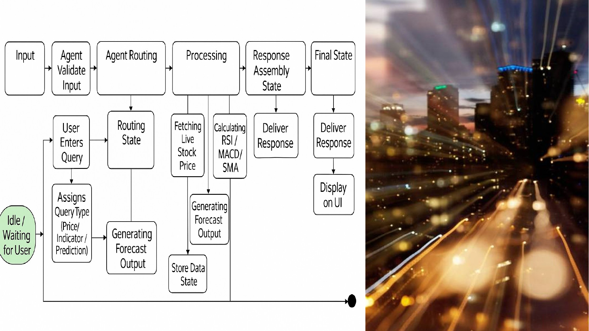
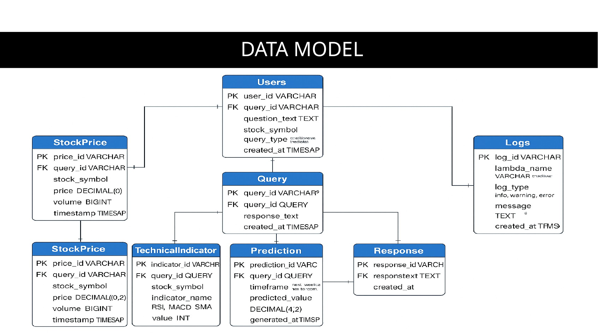
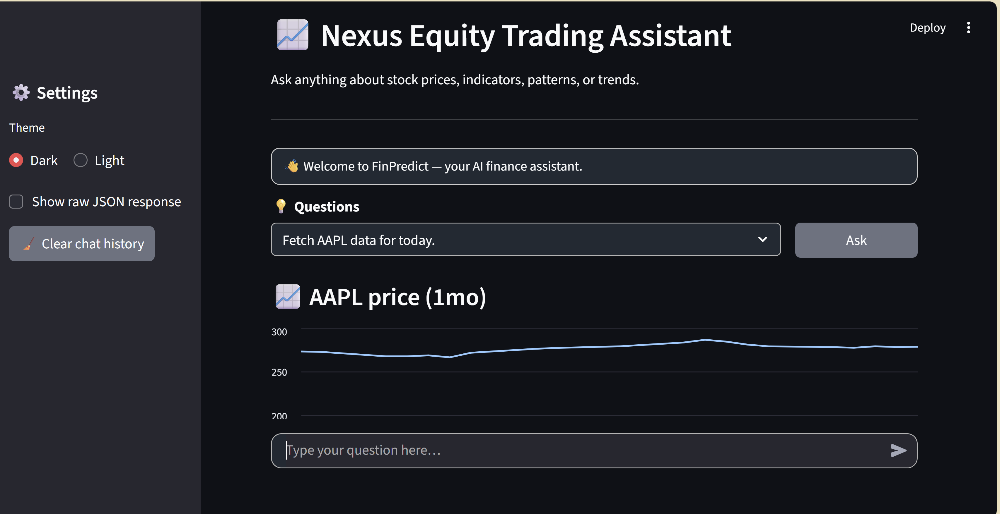
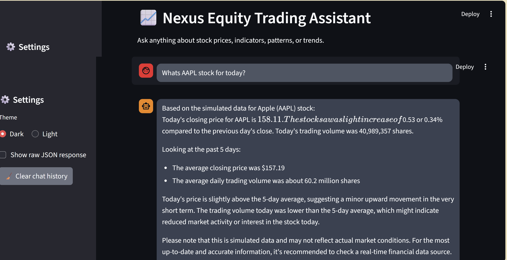

# Nexus Agent — Equity Trading AI Chatbot

An AI-powered equity trading chatbot built on AWS. Nexus Agent lets users ask questions about stocks in plain language and answers with real-time market data, technical analysis, and trend predictions — through a conversational interface powered by Amazon Bedrock (Claude).

Graduate Software Engineering Project, New York Institute of Technology (Sep 2025 – Dec 2025).

## What it does

- Fetches real-time and historical stock data (Alpha Vantage API)
- Computes technical indicators — RSI, SMA, EMA, MACD (pandas/NumPy)
- Generates trend predictions (direction, expected range, reasoning) with a Bedrock-powered Predictor Lambda
- Converses naturally via an Amazon Bedrock Agent (Claude model)
- Stores chat history and data in DynamoDB and S3

## Architecture

```
User → Frontend (React/Streamlit) → API Gateway → Lambda Proxy → Bedrock Agent (Claude)
     → Action Groups (Data Fetcher, Technical Analyzer, Predictor)
     → External APIs / S3 / SageMaker → Back to User
```

## AWS services used

Amazon Bedrock (Agents, Claude) · AWS Lambda · API Gateway · S3 · DynamoDB · Secrets Manager · IAM · Cognito · CloudWatch · Streamlit

## Project stages

1. **Environment setup** — AWS account, IAM roles, Bedrock model access, API keys in Secrets Manager
2. **Stock data & analysis logic** — three Lambda functions (Data Fetcher, Technical Analyzer, Predictor), outputs in S3
3. **Bedrock Agent orchestration** — agent + action groups + OpenAPI schemas, tested with real stock queries
4. **User interface & API layer** — proxy Lambda, API Gateway, chat UI hosted via S3 + CloudFront
5. **Monitoring, security & scaling** — CloudWatch logs and alarms, Cognito authentication, DynamoDB chat history

## Gallery







<table>
<tr>
<td></td>
<td></td>
</tr>
</table>



<table>
<tr>
<td></td>
<td></td>
</tr>
</table>

*Slides from the project presentation — the full 23-slide deck is in `docs/`.*

## Repository contents

- `lambda/data_fetcher.py` — fetches daily stock data from Alpha Vantage (API key loaded from AWS Secrets Manager, with a backup-secret fallback) and saves snapshots to S3
- `lambda/technical_analyzer.py` — RSI, SMA, EMA and MACD indicators with overbought/oversold signals
- `lambda/predictor.py` — builds a price-history summary and asks a Bedrock model for a JSON trend prediction
- `lambda/streamlit_proxy.py` — the Streamlit/API entry point: invokes the Bedrock Agent and the child Lambdas
- `docs/Nexus_Agent_Presentation.pptx` — the project presentation (23 slides: user stories, agile sprints, data-flow and use-case diagrams, architecture, data model)
- `images/` — screenshots of the working Streamlit UI

## Security note

No credentials are stored in this repository. API keys and secrets are kept in AWS Secrets Manager and supplied to the Lambda functions through environment configuration.
